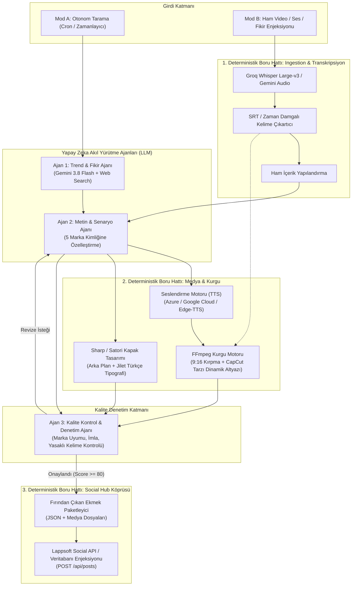

# Toprak — Mimari ve Teknik Tasarım

> **Sürüm:** 1.0.0  
> **Konum:** `c:\lappsoft_HQ\toprak\MIMARI_VE_TEKNIK_TASARIM.md`

---

## 1. Genel Mimari Şema

Toprak, **3 Akıl Yürütme Ajanı (LLM)** ve **3 Deterministik Boru Hattı (Kod/FFmpeg)** üzerine inşa edilmiştir.

---

## 2. İki Çalışma Modu: Mod A ve Mod B

### Mod A: Otonom Fırın (Daily Autonomous Routine)
* **Tetikleyici:** Zamanlanmış görev (haftanın belirli günleri, örn: Pazartesi - Çarşamba - Cuma saat 09:00).
* **İşleyiş:**
  1. `Trend & Fikir Ajanı` interneti ve sosyal medya gündemini tarar.
  2. 5 markanın sektörüne uygun viral konu başlıkları ve hook'lar çıkarır.
  3. `Metin & Senaryo Ajanı` 5 marka için ayrı metinler ve dikey görsel promptları hazırlar.
  4. `Medya Hattı` FLUX/Gemini arka planı üretir, Sharp ile marka renklerinde başlık ekler. İsteğe bağlı TTS ile 10 saniyelik hareketli reels videosuna dönüştürür.
  5. `Kalite Kontrol Ajanı` denetler ve onaylanan içerikler Social Hub kuyruğuna bırakılır.

### Mod B: Manuel Enjeksiyon (Injection Mode - En Yüksek Değer)
* **Tetikleyici:** Kullanıcının `toprak/storage/raw/` klasörüne video/ses atması veya bir API/komut satırı ile ham dosya/fikir iletmesi.
* **İşleyiş:**
  1. `Ingestion Pipeline`, videonun sesini ayırır ve Whisper large-v3 ile kelime kelime zaman damgalı transkript üretir.
  2. `Metin & Senaryo Ajanı`, bu videoda konuşulanları anlar; 5 markanın diline göre uyarlar:
     * *Lappsoft HQ için:* "Arka planda bunu nasıl kodladık?" temalı LinkedIn ve YouTube Shorts.
     * *Modena için:* "Bu fikir tarzınızı nasıl yansıtır?" temalı Instagram Reels.
     * *CareerAI için:* "Kariyerinizde bu tekniği nasıl kullanırsınız?" temalı TikTok.
  3. `FFmpeg Motoru`, kullanıcının ham videosunu alır; 9:16 dikey formata getirir, çıkarılan zaman damgalarıyla ekrana renkli, dinamik altyazı basar.
  4. Sharp ile videodan en iyi kare veya FLUX arka planı üzerine başlık basılarak 5 kapak görseli oluşturulur.
  5. Kalite kontrolünden geçtikten sonra paket Social Hub'a iletilir.

---

## 3. Akıl Yürütme Ajanları (LLM Spekleri)

### Ajan 1: Trend & Fikir Ajanı (`trend-agent.ts`)
* **Model:** `gemini-3.8-flash` (Google Search Grounding aktif).
* **Sorumluluk:**
  * Sektörel gelişmeleri (Yapay Zeka, Mobil Uygulamalar, Moda/Stil, Kariyer/İş Dünyası, Kripto/Finans) taramak.
  * Son 24-48 saatin en çok konuşulan başlıklarını listelemek.
  * Tıklama tuzağı (clickbait) olmayan ama merak uyandıran 3-5 adet viral "hook" üretmek.

### Ajan 2: Metin & Senaryo Ajanı (`copywriter-agent.ts`)
* **Model:** `gemini-3.8-flash` (Alternatif: `claude-3-7-sonnet` / `claude-3-5-haiku`).
* **Sorumluluk:**
  * Tek bir konuyu 5 markanın `markalar_sablonu.json` dosyasındaki DNA profiline (Tone of Voice, Hedef Kitle, Yasaklı Kelimeler) göre 5 farklı metne dönüştürmek.
  * Platform kurallarına uygun formatlamak (Instagram, TikTok, YouTube Shorts, X/Twitter, LinkedIn).
  * Video içerikler için 3 sütunlu senaryo tablosu (`[Görsel] | [Ekranda Metin] | [Seslendirme]`) üretmek.

### Ajan 3: Kalite Kontrol & Denetim Ajanı (`validator-agent.ts`)
* **Model:** Metni yazandan farklı model (Objektif denetim).
* **Kontrol Kriterleri:**
  1. *Marka Uyumu (0-100 Puan):* Markanın tonuna uyuyor mu? (Örn: Modena kurumsal bir dille konuşmamalı; Lappsoft HQ laubali olmamalı).
  2. *İmla ve Doğallık (0-100 Puan):* Basmakalıp yapay zeka lafları var mı? Cümleler akıcı mı?
  3. *Format Kuralları:* Karakter sınırları, hashtag adedi ve video süresi uygun mu?
  * **Eşik Değer:** 80 ve üzeri puan alanlar doğrudan onaylanır. 80 altı puan alanlar geri bildirim notuyla birlikte Metin Ajanı'na tek seferlik revizeye gönderilir.

---

## 4. Deterministik Boru Hatları (Kod & Araçlar)

### 1. Ingestion & Transkripsiyon Boru Hattı
* **Girdi:** `.mp4`, `.mov`, `.mp3`, `.wav` veya düz metin.
* **İşlem:**
  * `ffmpeg-static` ile videodan ses (`16kHz mono audio`) ayrıştırılır.
  * Groq Whisper Large-v3 API'sine gönderilir (`response_format: verbose_json`).
  * Kelime bazlı zaman damgaları (`word-level timestamps`) elde edilir.
* **Çıktı:** Standart JSON transkript ve kurgu için kullanılabilir `.ass` / `.srt` altyazı dosyası.

### 2. Medya & FFmpeg Kurgu Boru Hattı
* **Altyazı Stili:** CapCut tarzı; sarı/beyaz kelime vurgulu, okunabilir sans-serif fontlu dikey altyazı.
* **Görsel Boyutlandırma:** 9:16 (1080x1920) dikey dolgu ve kenarlık yönetimi.
* **Kapak Görseli (Thumbnail):**
  * `sharp` ile yüksek çözünürlüklü şablon.
  * Marka logosu sol üstte, kontrastlı Türkçe başlık görselin tam ortasında veya alt üçte birlik alanda.

### 3. Handoff & Entegrasyon Boru Hattı
* Kalite Kontrol Ajanı'nın onayladığı paketi alır.
* Lappsoft Social Hub'ın anlayacağı `createPostSchema` formatına dönüştürür.
* Paketleri Social Hub'ın API'sine basar veya doğrudan veritabanı kayıtlarını oluşturur.
